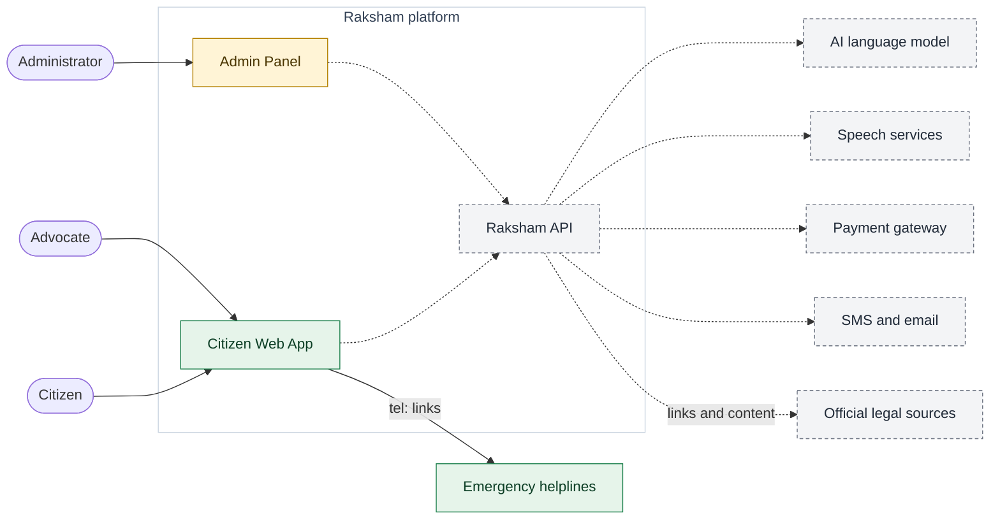

# 01 — System context

**What it shows:** who uses Raksham and which outside services it depends on. Inside details are in [02 — High-level design](02-high-level-design.md).

**Legend:** green = implemented, amber = scaffolded, grey dashed = planned. Dotted arrows are not yet connected.

## Key components

| Component | Role |
| --- | --- |
| Citizen | Anyone, including victims, seeking help from Sachi or a lawyer. |
| Advocate | Registers, is approved, then consults and takes bookings. Uses the same web app in an advocate area (proposed). |
| Administrator | Approves advocates and runs content, pricing, reports and refunds. |
| Citizen Web App | The public site, citizen area and advocate area. Only the UI shell exists. |
| Admin Panel | Separate back-office application. Scaffold only. |
| Raksham API | One backend serving both apps. Not started. |
| AI language model | Generates Sachi's plain-language answers from reviewed sources. Provider undecided. |
| Speech services | Voice-to-text and text-to-voice in Indian languages. Provider undecided. |
| Payment gateway | Takes the small chat and booking fees (UPI/cards). Provider undecided. |
| SMS and email | Account, booking and consultation notices. Provider undecided. |
| Official legal sources | Government and court sites whose pages Sachi links to and learns from. |
| Emergency helplines | Reached through phone links only; no data is shared. |
