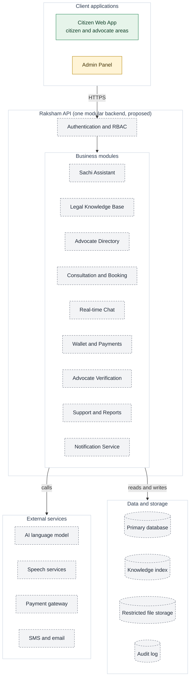

# 02 — High-level design (HLD)

**What it shows:** the complete platform in layers. Only the two client apps exist; the rest is the planned design, drawn dashed. The backend is **one modular application**, not many microservices.

**Legend:** green = implemented, amber = scaffolded, grey dashed = planned. The dotted arrow is a side effect of other work.

## How to read it

1. **Two clients, one gate.** The Citizen Web App (used by citizens *and* advocates, each with their own area) and the Admin Panel both go through **Authentication and RBAC**. Access is decided on the server by role: citizen, advocate or administrator.
2. **Business modules** are modules *inside one backend*, not separate microservices. That keeps the project simple to build, test and deploy; splitting later remains possible.
3. **External services** are used by specific modules, and **data** is stored in four places. The table below shows who uses what.
4. Every administrator change is written to the **audit log**.

## Who uses what

| Module | Talks to |
| --- | --- |
| Sachi Assistant | Legal Knowledge Base (reviewed sources), AI language model, Speech services |
| Legal Knowledge Base | Knowledge index, Primary database |
| Advocate Directory | Primary database |
| Consultation and Booking | Real-time Chat, Wallet and Payments, Primary database |
| Real-time Chat | Primary database (messages kept protected) |
| Wallet and Payments | Payment gateway, Primary database |
| Advocate Verification | Restricted file storage (documents), Primary database, Audit log |
| Support and Reports | Primary database, Audit log |
| Notification Service | SMS and email |

## Components

| Component | Responsibility | Status |
| --- | --- | --- |
| Citizen Web App | Public pages, Sachi chat/voice, advocate search, chat, booking, advocate workspace | UI shell implemented |
| Admin Panel | Approvals, content, pricing, reports | Scaffolded |
| Authentication and RBAC | Sign in, sessions, role checks (citizen, advocate, administrator) | Planned |
| Sachi Assistant | Understand the question, check for danger, retrieve sources, answer with steps, forms and links | Planned |
| Legal Knowledge Base | Reviewed legal content and official links; searchable index | Planned |
| Advocate Directory | Listing and filtered search of approved advocates | Planned |
| Consultation and Booking | Instant chat sessions and scheduled bookings | Planned |
| Real-time Chat | Live messages and session timer | Planned |
| Wallet and Payments | Per-block charges, payments, refunds, advocate earnings | Planned |
| Advocate Verification | Review of advocate applications | Planned (placeholder UI) |
| Support and Reports | Feedback, complaints, disputes | Planned (feedback form UI) |
| Notification Service | SMS and email notices | Planned |
