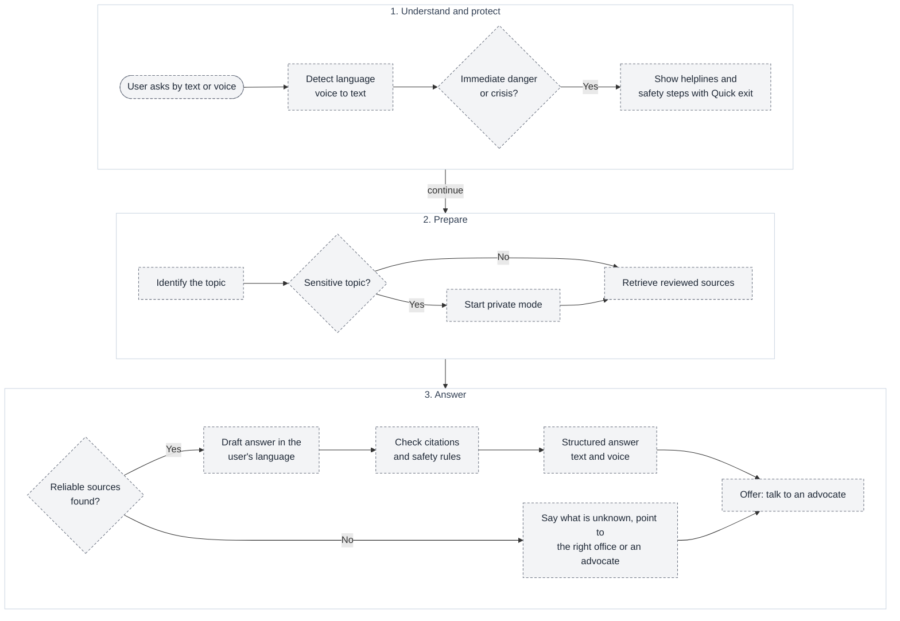
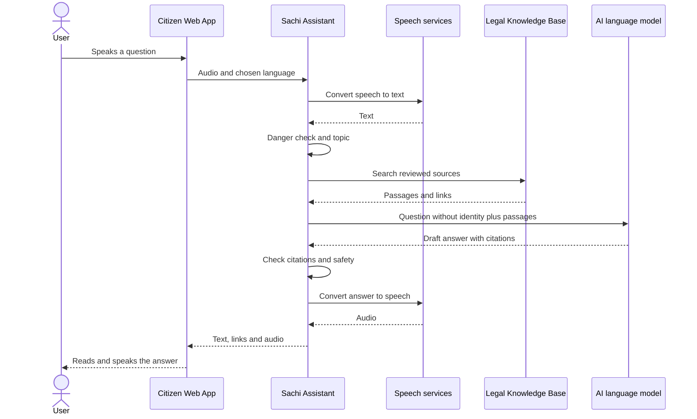

# 03 — Sachi, the AI legal assistant

**Sachi** is Raksham's AI assistant. A person asks a question by **text or voice, in their preferred language**, and Sachi explains the relevant rights, rules and facilities under Indian law in a clear, structured format with **links to official sources**. It is built to help people who are being harassed or treated unfairly know what they are entitled to and what to do next, privately.

> **Status: PLANNED.** Sachi is an owner requirement. Nothing is built, and the current website does not mention Sachi yet. The AI provider, speech provider and knowledge-base method are open decisions.

## Design principles

1. **Grounded, not guessed.** Answers come from a reviewed **Legal Knowledge Base** (laws, rights, department procedures, forms, official links). If reliable sources are not found, Sachi says so instead of inventing.
2. **Safety first.** Danger to life or safety is checked before anything else.
3. **Private by design.** Sensitive topics start in a private mode (see below).
4. **Plain language, own language.** Output in the user's language; voice in and out.
5. **Information, not legal advice.** Sachi always offers a hand-off to a real advocate.

## A. From question to answer

**What it shows:** the steps Sachi follows for every question.

All steps are planned.

## B. A voice question, end to end

**What it shows:** who talks to whom when someone speaks to Sachi.

Only the question text and the retrieved passages go to the AI model. Names, phone numbers and account details do not (see [09 — Security and privacy](09-security-privacy.md)).

## C. Situations Sachi is built for

These are **illustrative scenarios from the owner's requirements**. The exact laws and procedures in each answer would be taken from the reviewed knowledge base and verified by legal reviewers, not written in this document.

| Situation | What the user may say | How Sachi responds |
| --- | --- | --- |
| **Police stop or misbehaviour** (for example a biker stopped, keys taken, rude treatment) | "Police took my keys and are shouting at me." | Calm first line; explains the person's rights in a stop; what officers may and may not do; what to say and ask; how to record details (officer name, number, time); where to complain if rights are violated; helplines; offer advocate. |
| **Misconduct by any government employee** | "An official is demanding a bribe / misbehaving." | Explains the person's rights; the complaint route and the department or authority to approach; what proof to keep; relevant forms; links. |
| **Domestic violence** (any level) | "My husband hits me." | Danger check first; helplines (for example 181 and 112, already shown on the site); safety steps; the person's rights and the offices that help; support organizations; private mode; Quick exit; offer a woman advocate. |
| **Online harassment or blackmail** | "Someone is threatening to leak my photos." | Instant private guidance; stay-calm steps; **do not delete evidence**; how to preserve it; which department or portal to report to; the 1930 cyber-fraud helpline where relevant; forms and what to fill; rights; mental-calm tips; advocate hand-off. |
| **Offline harassment** | "A person follows and harasses me." | Rights; where to go (local authority); how to document; forms; support; advocate. |
| **Similar topics** ("other features like the same") | Consumer, property, tenancy, government services, general queries | Same pipeline; topic added by adding reviewed content, not by changing the system. |

## D. What every answer contains

| Section | Content |
| --- | --- |
| Summary | One or two plain sentences on the situation. |
| Calm note | A short, supportive line (especially for victims). |
| Your rights | The person's rights, with the source for each. |
| What to do now | Numbered steps in order. |
| Where to go | The department or office, and how to reach it. |
| Forms and documents | The forms to fill, what to attach, with official links. |
| Helplines | Relevant verified numbers. |
| Sources | Links to the official pages used. |
| Notice | General information, not legal advice. |
| Next step | "Talk to an advocate" button (see [04](04-advocate-consultation.md)). |

## E. Private mode for sensitive topics

For topics such as domestic violence, harassment and blackmail:

- Works **without sign-in**; no link to a name, phone or email.
- Conversation is **not saved** by default and is deleted when the session ends (the user may choose to save).
- Voice recordings are discarded after conversion to text.
- **Quick exit** is always visible; notifications never show sensitive content.
- Honest limits: encrypted in transit and at rest, but Raksham says it **cannot guarantee absolute anonymity**, as the sign-up page already states.

## F. Failure and edge cases

| Situation | Behaviour |
| --- | --- |
| Crisis detected | Helplines and safety steps before anything else. |
| No reliable source | State what is not known; point to the office or an advocate; never invent a law. |
| AI or speech service down | Fall back to text-only and to the reviewed resources and category pages. |
| Language not supported | Offer the closest supported language and say so. |
| Unclear question | Ask one or two short follow-up questions. |
