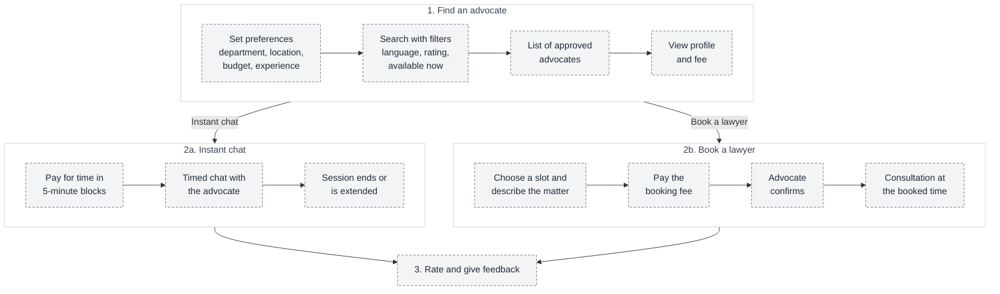
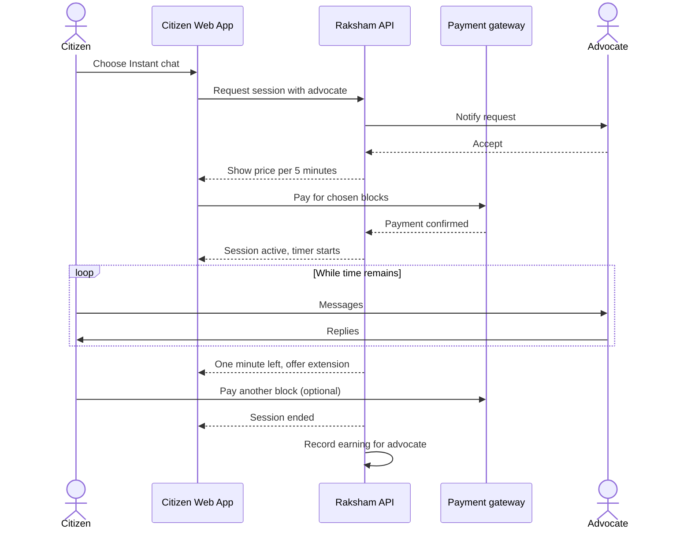
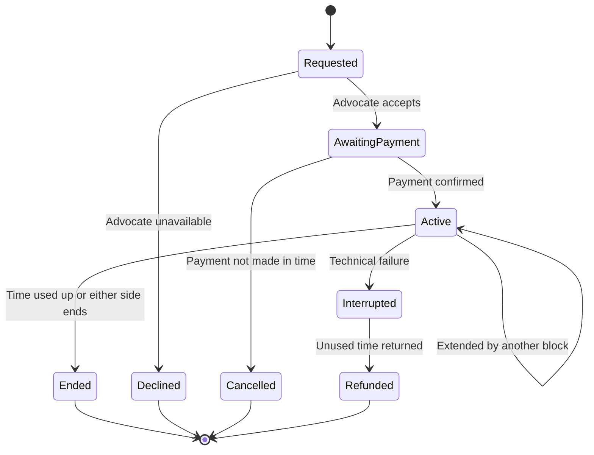

# 04 — Find and consult an advocate

**What it shows:** how a citizen finds the right lawyer from their preferences, then either starts a paid instant chat or books a lawyer. Approved advocates only; no advocate is shown until the administrator has approved them ([05](05-advocate-onboarding.md)).

> **Status: PLANNED** (owner requirement). Today the site has only a static "Human help" preview section; there is no search, chat, booking or payment.

## Preferences and filters

| Input | Meaning | Where it comes from |
| --- | --- | --- |
| **Department / area of law** and **jurisdiction** | For example criminal, family, cyber, consumer; and the state or court area | Owner requirement |
| **Location** | City or state of the advocate | Owner requirement |
| **Budget** | Maximum fee, for example per 5-minute block | Owner requirement |
| **Years of experience** | Minimum experience | Owner requirement |
| Language, rating, "available now", verified badge | Extra search filters | Proposed |

Saved preferences prefill the search; filters narrow the results.

## A. Search, choose and consult

**What it shows:** the full journey for both ways of consulting.

## B. Instant paid chat

**What it shows:** how an instant chat is started, paid, timed and closed.

## C. Session states

**What it shows:** the states a paid chat can be in.

## Pricing model

| Item | Design |
| --- | --- |
| Billing unit | **5-minute block**. A longer chat is charged "accordingly": two blocks for ten minutes, and so on. |
| Price level | The owner's example is **about ₹15–20 per 5 minutes**. Whether advocates set their own fee inside a band, and the exact band, are open. |
| When it is paid | Before the chat starts (prepaid blocks), with a one-tap extension near the end (proposed). |
| Raksham's share, taxes, gateway fees, advocate payouts | **Undecided.** |
| Unused time or a technical failure | Refund policy is open; the state diagram above shows a proposed refund path. |

## Booking ("hire") a lawyer

A booking is a scheduled consultation: the citizen picks a slot, describes the matter in a few lines, pays the booking fee, and the advocate confirms. What happens after the first consultation (a longer engagement and its fee) is **outside the platform's chat billing** and is an open question; Raksham connects the two parties and does not give legal advice itself.

## Rules

- Only **approved** advocates appear in search; suspended ones are hidden immediately.
- The chat is between the two parties; the platform records **who, when and how long**, and billing. Message content handling is an open decision (see [09](09-security-privacy.md)).
- Advocates are independent professionals; the site already states Raksham is not a law firm.
- Either side can report a conversation; reports go to Support and Reports ([06](06-admin-workflow.md)).
