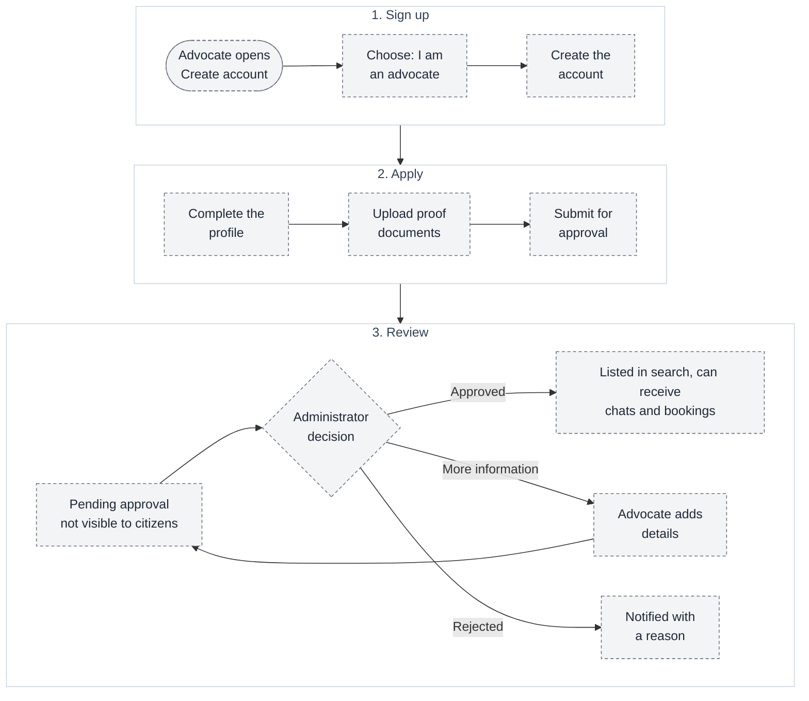
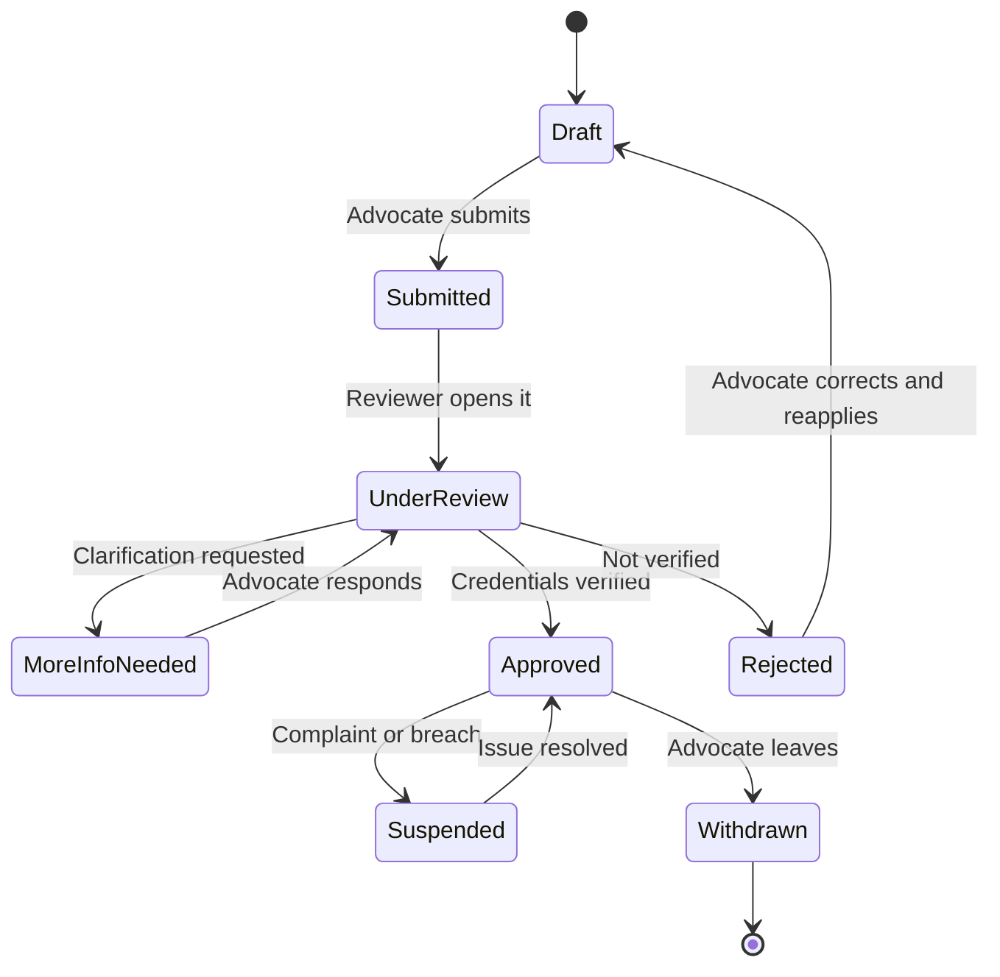

# 05 — Advocate onboarding and approval

**What it shows:** how an advocate registers from the sign-up page and becomes visible to citizens only after an administrator approves them.

> **Status: PLANNED.** The Create account page already has an advocate placeholder ("Are you an advocate? Apply for verification" and a "Pending approval" pill) that does nothing yet.

## A. Registration to listing

## What the advocate provides (proposed)

| Item | Why it is needed |
| --- | --- |
| Name, contact, photo | Identity shown in the listing |
| Bar enrolment details and proof documents | Basis for approval (exact checks to be defined with legal advice) |
| Practice areas and jurisdictions | Match the citizen's department and court-area filters |
| City and languages | Match location and language filters |
| Years of experience | Experience filter |
| Fee per 5-minute chat and booking fee | Budget filter and billing |
| Availability | "Available now" and booking slots |

## B. Advocate status

## Rules

- Only the **Approved** state shows the advocate in search or lets them take consultations.
- Every status change is made by an authorized administrator on the server and is written to the audit log ([06](06-admin-workflow.md)).
- The advocate and the administrator never share the same permissions; an advocate cannot approve themselves.
- Uploaded documents are private: visible to the reviewing administrator only, kept in restricted storage.
- Approval means Raksham checked listed credentials. It is **not** an endorsement of legal outcomes.
