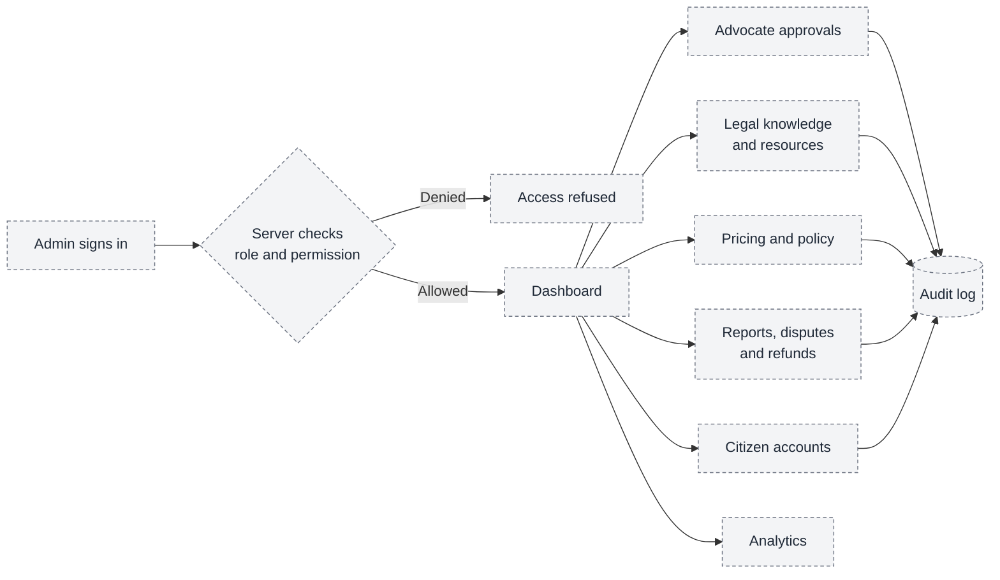
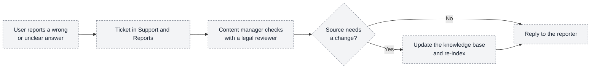
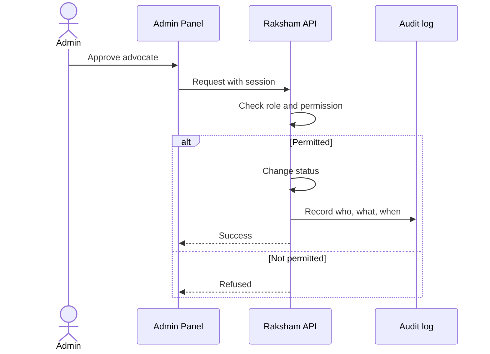

# 06 — Admin panel workflow

**What it shows:** how administrators run Raksham while access control and accountability are preserved.

> **Status: PLANNED.** The Admin Panel is only scaffolded; its empty folders (`dashboard`, `citizen-management`, `advocate-verification`, `legal-resources`, `support-tickets`, `consultations`, `payments`, `notifications`, `analytics`, `admin-management`, `audit-logs`) match this design. The roles below are **proposed**, not confirmed.

## A. What administrators manage

The server checks the role before any module opens, and every change is written to the audit log. The Admin Panel only shows or hides screens; it cannot grant access by itself.

| Module | What the administrator does | Scaffold folder |
| --- | --- | --- |
| Advocate approvals | Review applications, approve, reject, suspend ([05](05-advocate-onboarding.md)) | `advocate-verification` |
| Legal knowledge and resources | Add and review laws, rights, forms, links and official resources that Sachi uses | `legal-resources` |
| Pricing and policy | Set the allowed fee band per 5 minutes, booking rules, refund rules | `payments` |
| Reports, disputes and refunds | Handle complaints about chats, wrong Sachi answers, payment issues | `support-tickets`, `consultations` |
| Citizen accounts | Support and, if necessary, restrict accounts | `citizen-management` |
| Analytics | Usage and quality overview without personal details | `analytics` |
| Admin accounts | Create administrators and assign roles | `admin-management` |
| Audit log | Read-only history of admin actions | `audit-logs` |

## B. Keeping Sachi correct

**What it shows:** how a user's "this answer is wrong" report improves Sachi.

The footer feedback form on the site (types: Helpful, Not sure, Needs fixing) is the first, simulated, version of this report.

## C. An audited action

## Proposed administrator roles

| Role | Intended scope |
| --- | --- |
| Super Admin | Manage administrators and read the audit log |
| Verification Reviewer | Decide advocate applications |
| Content Manager | Maintain the knowledge base and official resources |
| Support Agent | Handle reports and tickets |
| Finance Agent | Handle pricing rules, payments, payouts and refunds |

The final role list is an open question ([11](11-architecture-decisions.md)).
