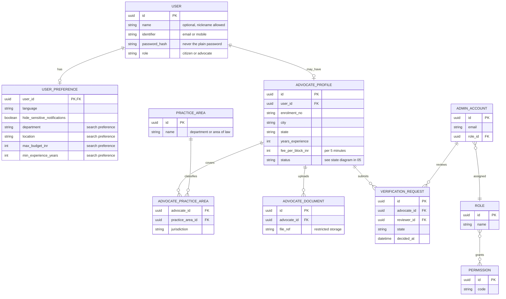
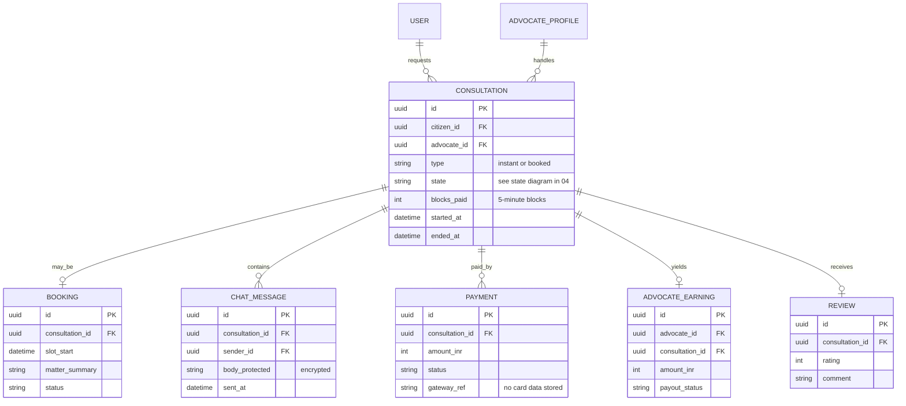
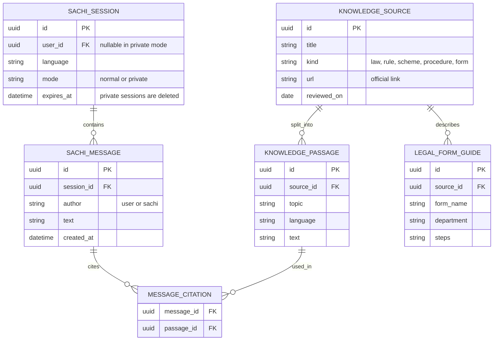
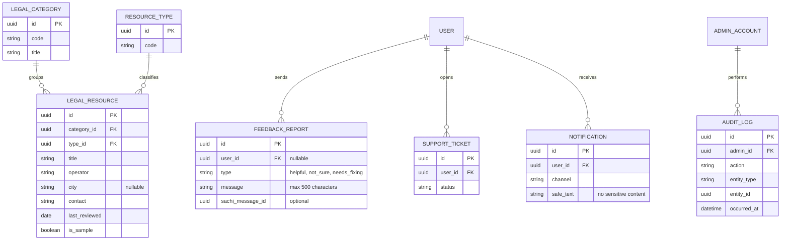

# 07 — Database entity-relationship diagrams

> **Status: PROPOSED conceptual model.** No database or schema exists yet and the database technology is undecided. The model is derived from the owner's requirements and from data shapes already in the frontend (resource fields, feedback types, preferences, form fields). It is split into four small diagrams.

## A. Accounts, advocates and administrators

**What it shows:** citizens, advocates (a kind of user), their approval, and administrator roles.

## B. Consultations, bookings and payments

**What it shows:** a paid chat or booking between a citizen and an advocate, with its messages, payments, earnings and review.

## C. Sachi and the legal knowledge base

**What it shows:** Sachi conversations and the reviewed sources they cite.

Private-mode sessions have no user link and expire; their messages are deleted with them.

## D. Resources, support and accountability

**What it shows:** official resources, user reports, and the audit history of administrator actions.

`AUDIT_LOG` is append-only history, kept apart from editable operational records. The resource and feedback attributes come from fields already in the frontend.

## Left out on purpose

Wallet and ledger details, payouts, taxes and commission (undecided); analytics tables; evidence uploads by citizens (not part of the stated requirements). No real data is used anywhere in this package.
