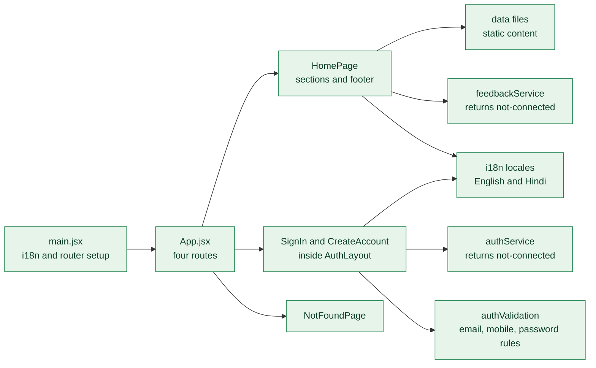
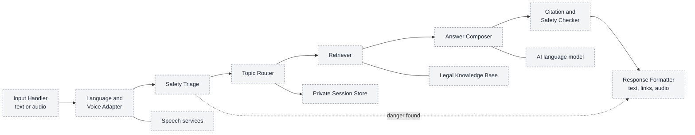
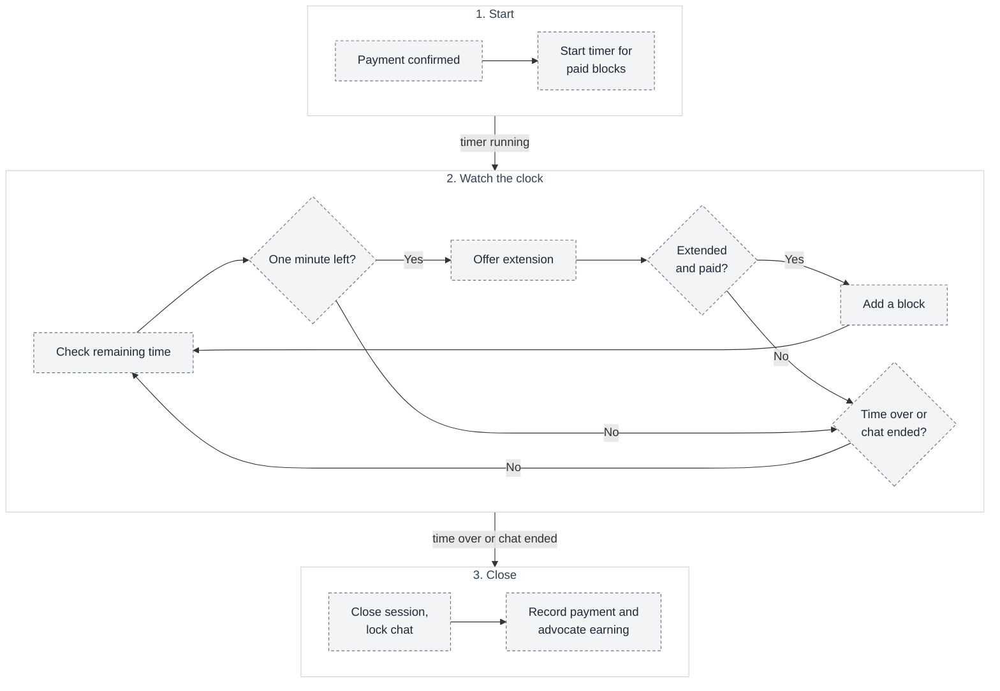

# 08 — Low-level design (LLD)

How the important parts work inside. Plain JavaScript/React has no class hierarchy worth drawing, so component, flow and state views are used only where they clarify something. The **Citizen Web App** part is verified from code; all backend modules are **planned**.

| Module | Status | Section |
| --- | --- | --- |
| Citizen Web App structure | Implemented (UI) | [A](#a-citizen-web-app-structure-implemented) |
| Sachi Assistant | Planned | [B](#b-sachi-assistant-internals) |
| Consultation timer and billing | Planned | [C](#c-consultation-timer-and-billing) |
| Authentication and RBAC | UI implemented, backend planned | [D](#d-authentication-and-rbac) |
| Advocate Directory | Planned | [E](#e-advocate-directory-search) |
| Chat, Wallet and Payments, Verification, Support, Audit | Planned | [F](#f-other-modules) |

## A. Citizen Web App structure (implemented)

Rules that already hold: text lives in locale files; services never report success because no backend exists; the chosen language is kept in `localStorage` and mirrored to `<html lang>`. New features (Sachi chat, advocate search, chat, booking) would be added under the reserved `features/` folders (`legal-assistant`, `advocate-discovery`, `consultations`, `user-account`) and call the API through `services/`.

## B. Sachi Assistant internals

**What it shows:** the components inside the Sachi Assistant module and the order they run in.

| Component | Responsibility | Rule |
| --- | --- | --- |
| Input Handler | Accept text or audio and the chosen language | Limit size; never log raw audio |
| Language and Voice Adapter | Detect language; speech to text and text to speech | Fall back to text if speech fails |
| Safety Triage | Detect danger or crisis | Runs first; can jump straight to helplines |
| Topic Router | Choose topic (police, government, domestic violence, online harassment, other) and decide private mode | Sensitive topics default to private mode |
| Retriever | Find reviewed passages and forms | Only reviewed content |
| Answer Composer | Ask the AI model to explain passages in the user's language | Prompt contains no identity |
| Citation and Safety Checker | Every claim needs a source; block unsafe advice | Drop unsupported statements |
| Response Formatter | Build the sections in [03](03-sachi-ai-assistant.md) with links | Always include notice and advocate hand-off |

## C. Consultation timer and billing

**What it shows:** how a paid chat is timed, extended and closed.

Rules: time is counted on the **server**, not the browser; a block is 5 minutes; the session cannot go negative; a technical failure moves the session to *Interrupted* and starts the refund path ([04](04-advocate-consultation.md)).

## D. Authentication and RBAC

| Aspect | Design |
| --- | --- |
| Roles | Citizen, advocate, administrator (admin roles in [06](06-admin-workflow.md)) |
| Implemented (UI) | Email or mobile and password rules (valid email or 10–13 digit mobile, at least 8 characters), terms and privacy acknowledgements, show/hide password, honest "not connected" messages |
| Planned | Sessions or tokens, password hashing, role checks on every request, advocate sign-up option, optional Google sign-in |
| Failure handling | Field errors with focus; password cleared after a failed attempt; never a fake success |
| Sachi without sign-in | Allowed in private mode (scope to be confirmed, as the sign-in page already says) |

## E. Advocate Directory search

| Aspect | Design |
| --- | --- |
| Inputs | Department, jurisdiction, location, maximum budget, minimum experience, plus language, rating, availability |
| Rule | Return only **Approved** advocates whose fee is within budget and experience is at least the minimum |
| Ranking (proposed) | Best match to department and jurisdiction, then location, then rating, then fee |
| Empty result | Show nearest alternatives and offer Sachi or a wider filter |
| Existing UI pattern | The resources directory already uses draft-then-search filtering with an empty state; the same pattern can be reused |

## F. Other modules

| Module | Responsibility and main rules |
| --- | --- |
| Real-time Chat | Deliver messages in a session; refuse messages after the session closes; protect message content ([09](09-security-privacy.md)) |
| Wallet and Payments | Create a payment, confirm it from the gateway's server notice (not the browser), record advocate earnings, refunds; store **no card data** |
| Advocate Verification | State changes in [05](05-advocate-onboarding.md); only reviewers may change state; invalid transitions are refused |
| Support and Reports | Tickets and reports on chats, payments and wrong Sachi answers; feeds the flow in [06](06-admin-workflow.md) |
| Notification Service | SMS or email; text for sensitive accounts never reveals the subject |
| Audit Logging | Append-only; written in the same operation as the change; not editable from the Admin Panel |
