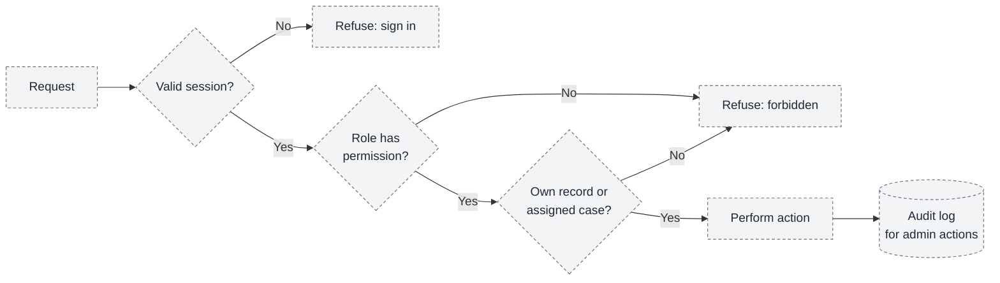
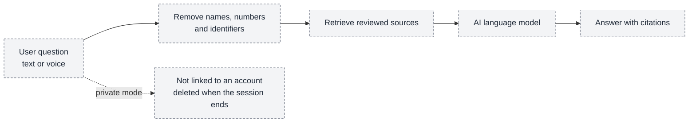

# 09 — Security and privacy design

Raksham will handle very sensitive situations (abuse, blackmail, legal troubles) and money. This document separates **controls that exist in code today** from **controls that are planned**. It does not claim Raksham is secure, compliant or production-ready.

## Implemented today (frontend, verified in code)

| Control | Where |
| --- | --- |
| Passwords never saved in `localStorage` or `sessionStorage`, never logged, cleared after a failed attempt | Sign in and Create account |
| No fake success: sign in, sign up, feedback and Google sign-in say plainly they are not connected | `authService`, `feedbackService` |
| Password hidden by default with an accessible show/hide toggle | Password input |
| **Quick exit** leaves the page at once (cannot erase browser history, and says so in code) | Auth screens |
| "Hide sensitive content in notifications" preference, on by default | Create account (preference only) |
| Warning not to put personal or sensitive details in free-text feedback | Footer feedback form |
| No secrets in `VITE_` variables (they are public) | Both frontends |

These are interface-level measures; none replaces server-side security.

## Planned controls

### Who can do what (proposed role model)

Every check is on the **server**. The apps only show or hide screens.

### Permission matrix (proposed)

R = read, W = create or change, D = decide, — = no access.

| Area | Citizen | Advocate | Administrator |
| --- | --- | --- | --- |
| Own account and preferences | R, W | R, W | — |
| Sachi (including private mode) | W | W | — |
| Advocate listings | R (approved only) | R, W (own profile) | R, D |
| Own consultations and chat | R, W | R, W | — (not message text) |
| Payments | R (own), W | R (own earnings) | R, W (finance role) |
| Legal knowledge base | R | R | R, W (content role) |
| Reports and tickets | W (own) | W (own) | R, W (support role) |
| Audit log | — | — | R (super admin) |

### Sachi privacy: what is sent where

- Only the question text and retrieved passages go to the AI provider. Account identifiers, advocate documents and chat messages never do.
- Voice is converted to text and the audio is discarded.
- The provider's data-retention terms must be reviewed before use (open).

### "End-to-end privacy" in plain terms

| Claim | What is realistic |
| --- | --- |
| Encrypted in transit (HTTPS) and at rest | Yes, planned |
| No identity needed for Sachi in private mode | Yes, planned |
| Nothing stored after a private session | Yes, planned |
| True end-to-end encryption **between citizen and advocate chat** | Possible, but it prevents the platform from moderating abuse; an open decision |
| True end-to-end encryption **with the AI** | Not possible, because the AI must read the question; privacy comes from minimization and deletion instead |
| Absolute anonymity | **Not promised.** The sign-up page already says Raksham cannot guarantee it. |

### Money and documents

- **Payments:** card and UPI details are handled only by the payment gateway; Raksham stores a reference and the amount. Payment success is confirmed from the gateway's server notice, not from the browser.
- **Advocate documents:** restricted storage, visible only to the reviewing administrator, short-lived access links, every access logged.
- **Separation of duties:** an advocate cannot approve themselves; the person who decides applications cannot administer roles; nobody can edit the audit log from the Admin Panel.
- **Safe notifications:** SMS and email never include case or topic details.

## Key risks and mitigations

| Risk | Mitigation (status) |
| --- | --- |
| A victim's device is shared with an abuser | Quick exit and hidden-notification setting (UI today); private mode, no saved history, neutral notices (planned) |
| Sachi gives wrong or invented law | Answers only from reviewed sources, citation check, legal review of content, "report wrong answer" loop, disclaimers (disclaimers exist; rest planned) |
| Fake advocates | Admin approval with document checks; suspension (planned) |
| Misuse of the paid chat (fraud, harassment) | Report button, session records, suspension (planned) |
| Payment fraud or double charging | Gateway confirmation, idempotent payment records (planned) |
| Admin misuse | Roles, separation of duties, audit log (planned) |
| Secrets in frontend bundles | No secrets in `VITE_` variables (rule in place) |
| Outdated helplines or sources | Verify helplines against official sources before launch; `reviewed_on` date on every source |
