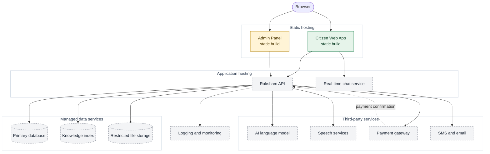

# 10 — Deployment architecture

## What is verified

- Both frontends build to static files with `npm run build` (Vite output in `dist/`).
- The Citizen Web App uses client-side routes (`/auth/sign-in`, `/auth/create-account`), so its host **must rewrite unknown paths to `index.html`**, otherwise refreshing those pages returns 404.
- Configuration is by `VITE_` variables (`VITE_API_BASE_URL`, `VITE_QUICK_EXIT_URL`); they are public values baked into the build.
- A live production site of the Citizen Web App exists, but **no deployment configuration is in the repository** and its host is not recorded.
- No backend, database, storage, AI, speech or payment service is deployed, because none exists.

## Proposed deployment (not confirmed)

> **Status: PROPOSED.** Vendors are deliberately not named; choosing them is an open decision.

**Legend:** green = built (host unrecorded), amber = scaffolded, grey dashed = proposed.

## Notes

| Topic | Proposal |
| --- | --- |
| Admin separation | Admin Panel on its own address, not linked from the public site |
| Real-time chat | Needs a long-lived connection (WebSocket); can be part of the API host at first |
| Payment confirmation | The gateway calls back the API; the API trusts that call, not the browser |
| Secrets | Held by the hosting platform for the API; none in any frontend |
| Environments | Separate `VITE_API_BASE_URL` for development and production |
| Monitoring | Application logs and uptime checks; the audit log stays in the database, apart from operational logs; no message text or Sachi questions in logs |
| CI/CD | Not set up; build and lint should run on every push |
